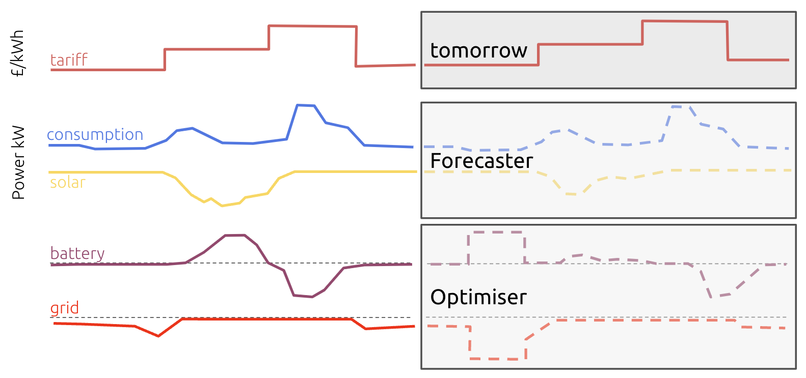
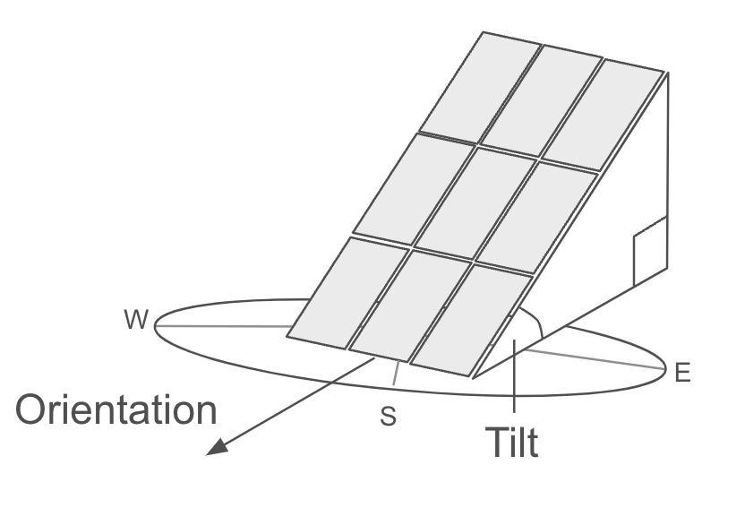
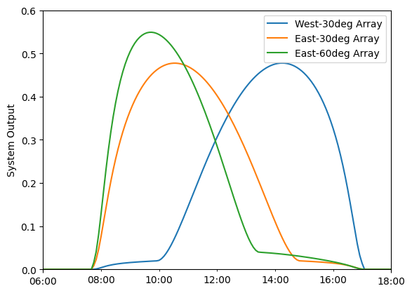
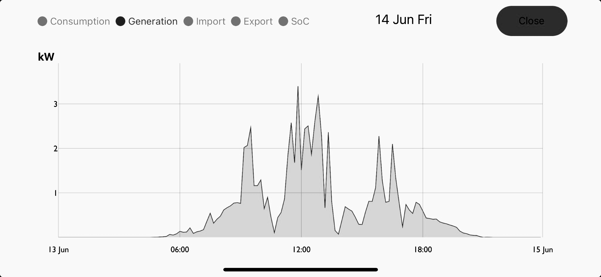
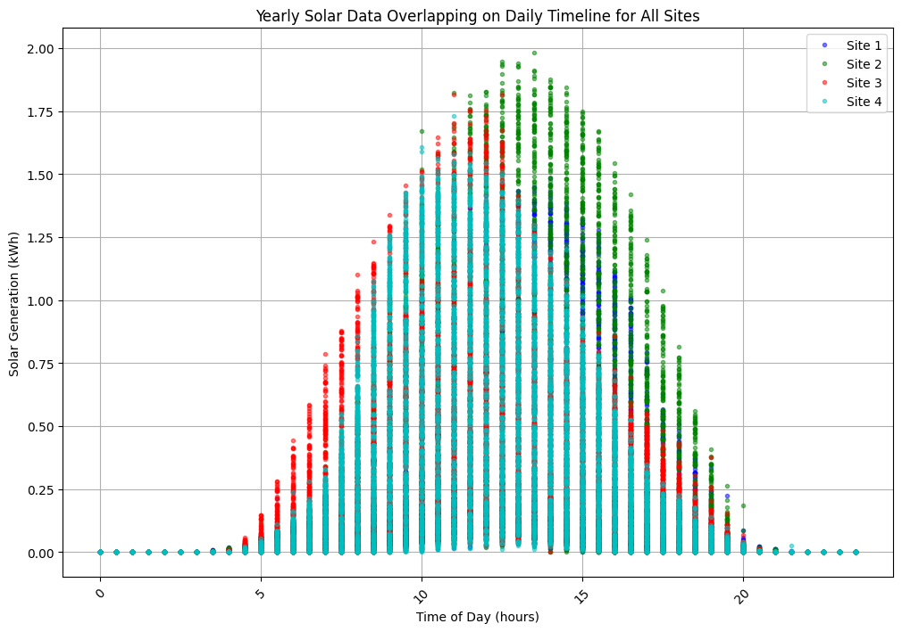
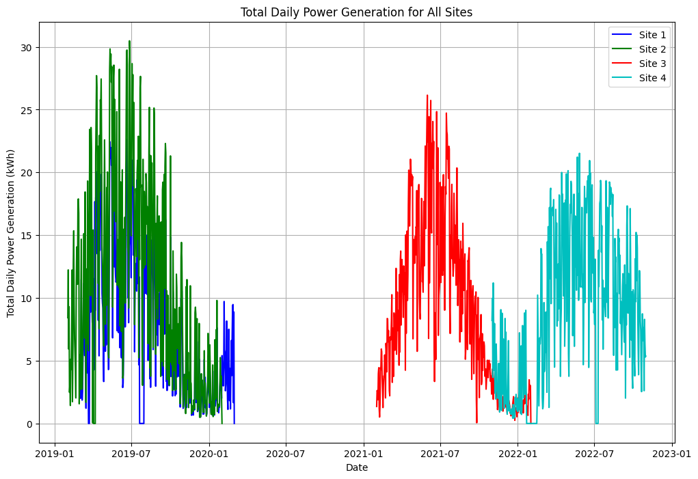
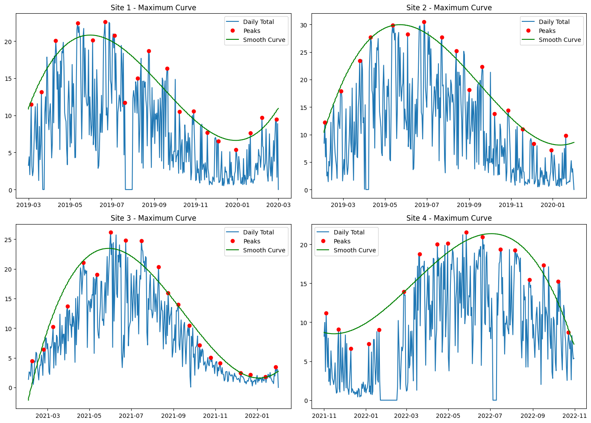
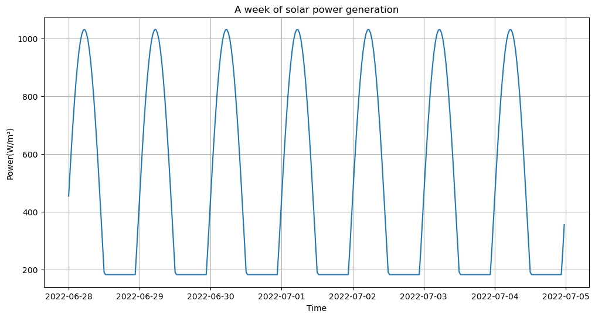
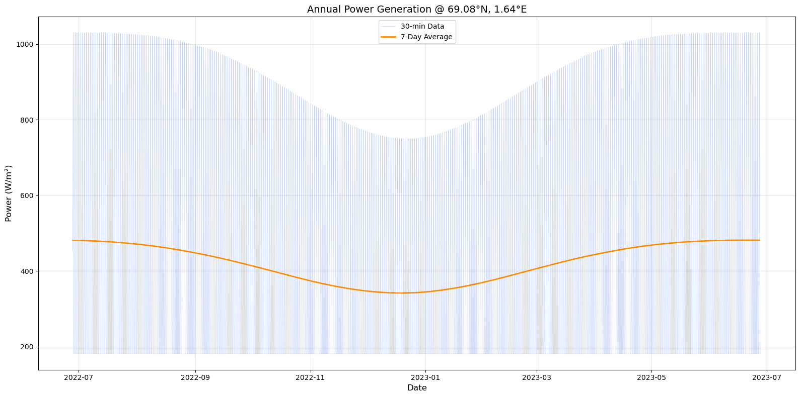

# Inverse identification of PV array parameters

Given a 30-minute generation time series and a known location, recover the array’s **tilt**, **orientation**, and **DC capacity**. This is an inverse / calibration problem: a physics forward model maps parameters to a generation curve; the task is to invert that map.

This repository is a cleaned public snapshot of an Imperial College group project with Powerverse. The raw customer time series are **not** included. What is public is the method, a reproducible pvlib simulator, one synthetic sample, the preprocessing plots below, and the original lab metrics — reported honestly.

The group write-up is [`docs/SolarPanelAnnoted.pdf`](docs/SolarPanelAnnoted.pdf).

## Background

Powerverse runs a home energy optimiser. It needs a solar forecast, and a forecast needs the array’s size and the direction it faces. Customers often do not know those numbers. The brief asks whether generation data plus a known location is enough to recover them.



A fixed array is three numbers: tilt (angle up from horizontal), orientation (compass heading), and capacity (kWp).



On a clear day those two angles move the peak. East-facing arrays peak in the morning; a steeper tilt raises and narrows that peak. A west-facing array peaks in the afternoon.



A real day does not look like that curve. Clouds break the envelope, which is why a fit on raw kWh is not the same problem as a fit on clear-sky irradiance.



## Problem

Residential solar assets are often poorly labelled. Operators see a generation series and a meter location, but not the physical array geometry. Tilt, azimuth and kWp determine the seasonal envelope and the daily peak time. If those parameters can be inferred from production, downstream forecasting and asset registers improve.

The intended pipeline is:

```text
pvlib clear-sky simulator  -->  synthetic labelled panels
daily envelope / denoising -->  features (partially implemented)
supervised inverse model   -->  (kWp, tilt, azimuth)
```

A serious version of this problem would fit a physics model first (nonlinear least squares on clear-sky days), then use machine learning on the residual. That baseline was not built. The neural net below should be read as an experiment, not as a solution.

## Data

**Public.** One synthetic site: [`data/synthetic/sample_site_0.csv`](data/synthetic/sample_site_0.csv). Columns: `timestamp_utc`, `site_id`, `latitude`, `longitude`, `pv_dc_kwp`, `pv_array_tilt`, `pv_array_a_orientation`, `solar_gen_kwh`.

Regenerate a 100-site training panel (gitignored):

```bash
python src/generate_synthetic.py --n-sites 100 --seed 42
```

The forward model uses pvlib solar position and plane-of-array irradiance at 30-minute resolution, with a 15% system-loss factor. Weather / cloud cover is **not** modelled. Capacity is stored as a random label and is **not** multiplied into the irradiance — a mismatch carried over from the original generator.

**Private.** Four UK sites of 30-minute kWh (2019–2022), with 4,118 missing generation values. Those files stay in `data/real/` locally if you have them; they are gitignored. Notebooks 02 and 03 fall back to the synthetic sample when real files are absent.

## Method

1. **Forward simulation** — [`src/generate_synthetic.py`](src/generate_synthetic.py) and [`notebooks/01_synthetic_generation.ipynb`](notebooks/01_synthetic_generation.ipynb). Monte Carlo sites over Europe; clear-sky POA irradiance.
2. **Envelope regression** — [`notebooks/02_yearly_envelope.ipynb`](notebooks/02_yearly_envelope.ipynb). Daily totals, `find_peaks`, UnivariateSpline fit to the upper envelope. Intended features (time of daily max, relative amplitude) were specified but not wired into the model.
3. **Denoising** — [`notebooks/03_denoising.ipynb`](notebooks/03_denoising.ipynb). Moving average and median filter, window 50. Exploratory; no held-out smoother selection.
4. **Inverse MLP** — [`notebooks/04_inverse_nn.ipynb`](notebooks/04_inverse_nn.ipynb). Cyclic calendar features, `StandardScaler`, an EnhancedNN (BatchNorm, GELU, Dropout), AdamW + early stopping. Weights: [`models/best_model.pth`](models/best_model.pth).
5. **Interactive overlay** — [`src/interactive_power_generator.py`](src/interactive_power_generator.py). Matplotlib sliders vs the synthetic sample. A calibration demo, not an optimiser.

[`notebooks/05_lstm_sketch.ipynb`](notebooks/05_lstm_sketch.ipynb) is an unrun sequence-model sketch. It is not a result.

## Preprocessing

These three figures are the feature pass on the four sites, not model scores. Site labels only; coordinates stay out of the repository.

A full year of 30-minute kWh, folded onto the hour of day. Orientation is what moves the clock time of the peak. The vertical spread at each hour is weather, not a second array.



The same series summed to one energy total per day. Each site in this extract covers a different year, and the seasonal hump is the signal tilt is supposed to change.



Daily result of that pass: `find_peaks` on the daily totals, then a UnivariateSpline through the upper envelope. The green curve is the clear-day seasonal shape. Those features were specified and were not passed into the network.



## Results

Figures below are from the original lab run. They were not regenerated for this snapshot.

Clear-sky week and annual envelope from the pvlib generator:





Inverse-net snapshot on a random 80/20 **row** split of synthetic 30-minute samples:

| Target | MAE | MAPE |
| --- | ---: | ---: |
| `pv_dc_kwp` | 0.06 | 90.27% |
| `pv_array_tilt` | 0.07 | 27.32% |
| `pv_array_a_orientation` | 0.07 | 43.93% |

MAE in native units is implausibly small next to those MAPEs. In the lab notes the capacity relative-error histogram has a mass near zero and a long tail of thousands of percent, which is what a denormalisation or wrong-column inverse-transform looks like. **Do not read this table as a claim that capacity is identified.** That histogram is omitted here; the plots above are the preprocessing analysis.

Validation is a shuffled row split, not site-level holdout and not temporal extrapolation. Training rows from the same site appear on both sides of the split.

## Limitations

- Clear-sky only: no NREL PSM3 / satellite weather, so cloud noise is missing.
- Capacity label is unused in the forward irradiance.
- No physics baseline (NLLS / ABC on tilt, azimuth, kWp).
- Inverse-net evaluation is likely wrong-scale; leakage from row-wise splits.
- Envelope features were never passed into the network.
- LSTM sketch never ran.

Future work that would actually strengthen the result: site-level cross-validation, a clear-sky NLLS baseline, weather-aware forward simulation, and a metric computed in original units with an explicit inverse scaler.

## How to run

Python 3.10+.

```bash
python -m venv .venv
source .venv/bin/activate
pip install -r requirements.txt

python src/generate_synthetic.py --n-sites 1
python src/interactive_power_generator.py
```

Then open the notebooks in order (`01` … `04`). Notebook `04` loads `models/best_model.pth`; it does not retrain by default.

## Repository layout

```text
src/            forward simulator, interactive overlay, toy MLP
notebooks/      01 simulator, 02 envelope, 03 denoising, 04 inverse net, 05 LSTM sketch
data/synthetic  public sample; generated/ is gitignored
data/real       local proprietary files only (gitignored)
models/         saved EnhancedNN weights and scaler
docs/figures    plots used in this README
archive/        early lab notes, not maintained
```

## Credit

Group project, Imperial College, with Powerverse. Public snapshot assembled for a quantitative-research portfolio. Teammate modules in `archive/` are not claimed as individual work.
